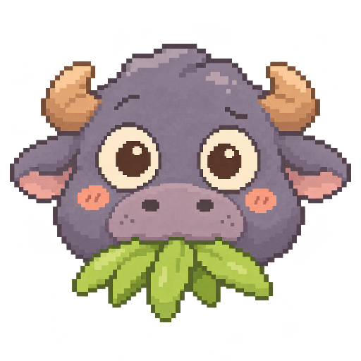
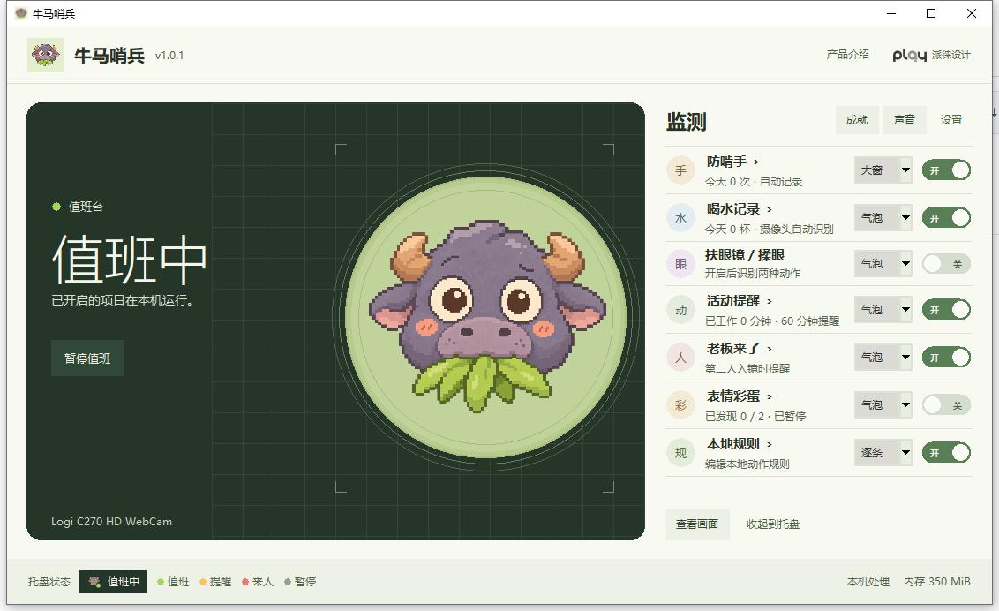
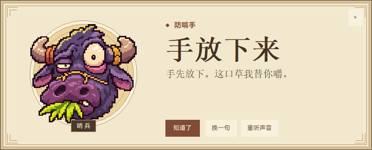
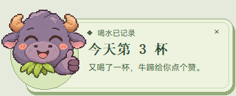
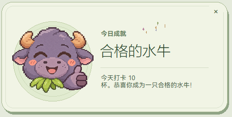

<p align="center"></p>

<h1 align="center">NiuMa Sentinel · 牛马哨兵</h1>

<p align="center">Bite your nails less, remember each glass of water, and take a break when a session runs long.</p>

<p align="center">
  <a href="https://github.com/lipeilin3861/niuma-sentinel/releases/latest">Download for Windows</a>
  · <a href="README.md">简体中文</a>
  · <a href="LICENSE">Apache-2.0</a>
</p>

**NiuMa Sentinel is a Windows desktop habit companion by PLAY atelier.** It uses your webcam to recognize everyday actions on your computer. Enable the habits you care about, choose how you want to be reminded, and let the little ox watch from the tray. It runs offline without an account.



## What it does

| Feature | How it helps |
| --- | --- |
| **Nail biting** | Reminds you when it detects a sustained nail-biting gesture and adds one event to your daily count. |
| **Water log** | Estimates a drink from a cup or bottle and the movement of the hand holding it. Undo a miscount or set a hydration interval. |
| **Glasses and eye rubbing** | Optional prompts for adjusting glasses or rubbing your eyes. |
| **Movement breaks** | Reminds you to stand up after 60 or 90 minutes at the computer. |
| **Second-person alert** | Turns the tray icon red when another person enters the frame, with a choice of reminder style. Saving visitor photos has its own switch and is off by default. |
| **Achievements and sounds** | Unlock badges for habits and facial expressions. Shuffle through 20 piglet sounds, preview them, or mute them. |
| **Local rules** | Adjust the proximity, hold time, and reminder style for a hand near the eyes, mouth, or nose. [Example rules](rules/defaults.json) |



Choose between a centered dialogue and a five-second corner toast. The ox gives a thumbs-up when a drink is logged and throws a little confetti when you hit a daily goal.

| Hydration toast | Hydration achievement |
| --- | --- |
|  |  |

The screenshots show the current Chinese interface and sample reminder counts. Lighting, camera placement, and occlusion affect recognition. The app lets you adjust what it monitors and undo incorrect water entries.

## Why we built it

It started with one small problem. At the desk, by the time you notice that you're biting your nails, your hand is already there. We wanted a reminder for that moment. The same desktop companion could notice a drink of water or nudge you to get up after a long stretch of work.

“NiuMa” is a Chinese in-joke about being a workhorse. We made ours an ox with a mouthful of grass. Game-style dialogue, piglet sounds, and a small celebration turn a reminder into a bit of office humor. Small prompts can appear in the corner. The larger window is there for moments that need your attention. You decide what the camera watches for and how often the app interrupts you.

We kept recognition on the computer so the app can stay open without a cloud AI subscription. By opening the source, we hope others will adapt the rules to habits that matter to them.

## Install and privacy

1. Download `NiuMaSentinel-v1.0.1-Windows-x64-Setup.exe` from Releases. Use Windows 10 or 11 x64 with a working webcam. [Download and checksums](https://github.com/lipeilin3861/niuma-sentinel/releases/latest)
2. Open NiuMa Sentinel from the Start menu. Enable the features you want and choose a centered dialogue or corner toast for each.
3. Closing the main window sends it to the tray. Right-click its tray icon to pause monitoring or quit and release the camera.

Camera frames are processed on the computer. The installed app stores preferences, counts, and imported audio under `%LOCALAPPDATA%\PlayAtelier\NiuMaSentinel`. Uninstalling keeps this directory. Optional visitor records keep photos and the owner's enrollment data in its `visitors` subdirectory. You can view and delete records in the app. Let affected people know before using visitor recording in shared spaces and obtain any consent required in your setting.

## Run from source

Use Windows x64, Python 3.12.16 with Tk, and uv. Dependency setup and the first model download require internet access. You can also pass the path to a downloaded Python interpreter to `uv venv --python`. [Python runtime used for the build](https://github.com/astral-sh/python-build-standalone/releases/tag/20261110)

```powershell
uv venv --python 3.12.16 .venv
uv pip install --python .venv/Scripts/python.exe -r requirements.txt -c packaging/release-constraints.txt
.\packaging\fetch_models.ps1
.\.venv\Scripts\python.exe app.py
```

To build the installer, add NSIS's `makensis.exe` to PATH. The build produces `build/NiuMaSentinel-Setup.exe`.

```powershell
uv pip install --python .venv/Scripts/python.exe -r requirements.txt -r packaging/requirements-build.txt -c packaging/release-constraints.txt
.\packaging\build_release.ps1 -MakeNsis (Get-Command makensis.exe).Source -YuNetNotice .\models\YuNet-LICENSE.txt -BuildDirectory .\build
```

## Contribute and follow PLAY atelier

When reporting false detections or hardware compatibility issues, include the app version, Windows version, and camera model. Report security or privacy problems privately. If this little ox helped you, a GitHub Star is always welcome. [Open an issue](https://github.com/lipeilin3861/niuma-sentinel/issues) · [Security policy](SECURITY.md)

Created by **Li Qiangqiang and Zhang Diedie (李呛呛 + 张喋喋)**. PLAY atelier (派徕设计) is Li Qiangqiang's one-person company (OPC) practice, based in Shenzhen. **We make playful design.** We work across architecture, interiors and spaces, exhibitions, and product design. [PLAY atelier website](https://www.playatelier.cn/)

Search for **李呛呛** on **Xiaohongshu (RedNote), Douyin, and WeChat Channels** for studio projects, day-to-day design work, and playful products.

The project code is open source under Apache-2.0. PLAY atelier branding, product marks, mascots, and third-party assets have separate terms. [Code license](LICENSE) · [Asset and third-party notices](THIRD-PARTY.md)

Contact [986592286@qq.com](mailto:986592286@qq.com)
