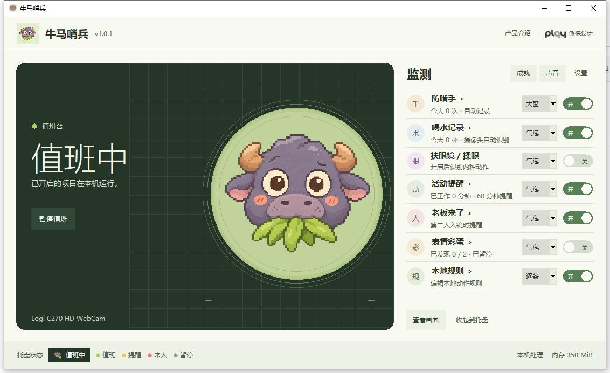
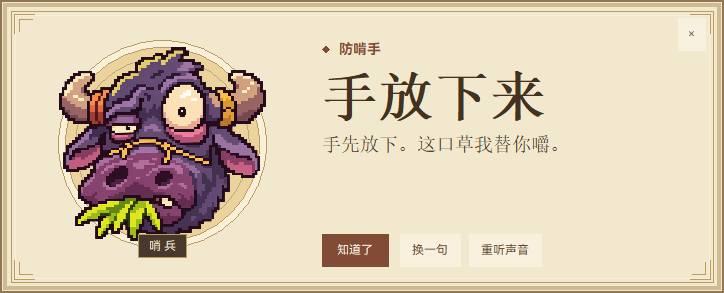
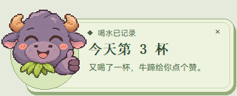
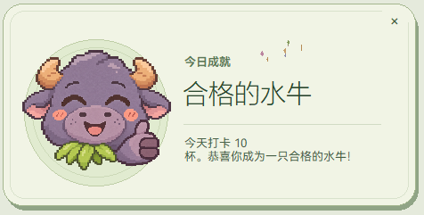

<p align="center"></p>

<h1 align="center">牛马哨兵</h1>

<p align="center">少啃一次手，记住每杯水，忙久了起来动一动。</p>

<p align="center">
  <a href="https://github.com/lipeilin3861/niuma-sentinel/releases/latest">下载 Windows 安装包</a>
  · <a href="README.en.md">English</a>
  · <a href="LICENSE">Apache-2.0</a>
</p>

**牛马哨兵是派徕设计做的一款 Windows 桌面习惯助手。** 它用摄像头在电脑本机识别动作，提醒你少啃手、自动记喝水。每项监测都可以单独设置。挑好需要的提醒，就让小牛在托盘值班。运行时无需注册，支持离线使用。



## 能帮你做什么

| 功能 | 平时怎么用 |
| --- | --- |
| **防啃手** | 识别一段持续的啃手动作，弹窗提醒并记入当天次数。 |
| **喝水记录** | 从杯子、瓶子和持物动作推断一次喝水。可以撤销误记，也可以设定补水间隔。 |
| **扶眼镜与揉眼** | 可选开启。识别对应手部动作，在动作发生时提醒。 |
| **活动提醒** | 连续用电脑 60 或 90 分钟，提醒你站起来动一动。 |
| **老板来了** | 第二个人入镜时托盘亮红，可选提示样式。访客照片另有开关，默认关闭。 |
| **成就与声音** | 日常习惯和表情可解锁成就。20 段小猪哨声可随机播放、试听或静音。 |
| **本地规则** | 可自行调整指尖接近眼睛、嘴唇和鼻子的距离、时长与提示方式。[规则示例](rules/defaults.json) |



提醒有中央大窗和五秒气泡。喝水记一杯时，小牛会比赞，当天达成目标还会撒一把小纸花。

| 喝水气泡 | 喝水成就 |
| --- | --- |
|  |  |

以上提醒截图使用示例数据。摄像头角度、光线和遮挡会影响识别，可以在应用里调整监测和撤销误记。

## 初心与设计

最早想解决的只有一件小事。坐在电脑前做设计时，等意识到自己在啃手，手早就到嘴边了。于是我们想做个提醒，在那个具体的瞬间叫你一声。顺手喝口水、做久了站一站，这些也可以交给同一只牛。

「牛马」是我们对埋头工作的自嘲。叼草的小牛、带点古风的游戏对话框和小猪哨声，让一个提醒像办公室里的一次打趣。小事用一个会自己收起的气泡，需要看清的动作才用大窗。监测的范围和打扰的程度，交给坐在电脑前的人决定。

我们把识别留在本机，让这个东西开着也不必买模型额度。开放代码是希望其他人也能按自己的生活改规则，把同一个想法用于更多值得提醒的小事。

## 安装与隐私

1. 在 Releases 下载 `NiuMaSentinel-v1.0.1-Windows-x64-Setup.exe`。需要 Windows 10 / 11 x64 和可用的摄像头。[下载页与校验文件](https://github.com/lipeilin3861/niuma-sentinel/releases/latest)
2. 安装后从开始菜单打开「牛马哨兵」。在值班台开关监测，在对应行选择「大窗」或「气泡」。
3. 关闭主窗会收起到托盘。右键托盘图标可以暂停监测或完全退出并释放摄像头。

摄像头画面在本机处理。安装版的设置、计数和自定义音频保存在 `%LOCALAPPDATA%\PlayAtelier\NiuMaSentinel`。卸载保留这份数据。可选的访客记录会把照片与登记特征存到该目录下的 `visitors`，可在访客面板查看和删除。用于共享办公空间时请先告知受到影响的人，并按适用规则取得同意。

## 从源码运行

在 Windows x64 准备带 Tk 的 Python 3.12.16 和 uv。安装依赖和首次下载模型需要联网。也可将已下载的 Python 解释器路径传给 `uv venv --python`。[构建用 Python 运行时](https://github.com/astral-sh/python-build-standalone/releases/tag/20261110)

```powershell
uv venv --python 3.12.16 .venv
uv pip install --python .venv/Scripts/python.exe -r requirements.txt -c packaging/release-constraints.txt
.\packaging\fetch_models.ps1
.\.venv\Scripts\python.exe app.py
```

构建安装包需要把 NSIS 的 `makensis.exe` 放在 PATH 中。输出文件是 `build/NiuMaSentinel-Setup.exe`。

```powershell
uv pip install --python .venv/Scripts/python.exe -r requirements.txt -r packaging/requirements-build.txt -c packaging/release-constraints.txt
.\packaging\build_release.ps1 -MakeNsis (Get-Command makensis.exe).Source -YuNetNotice .\models\YuNet-LICENSE.txt -BuildDirectory .\build
```

## 参与与派徕设计

报告误识别和设备兼容问题时，欢迎附上软件版本、Windows 版本和摄像头型号。安全与隐私问题走私密渠道。如果这只牛帮到了你，欢迎点个 Star。[提交 Issue](https://github.com/lipeilin3861/niuma-sentinel/issues) · [安全问题报告](SECURITY.md)

制作人 **李呛呛 + 张喋喋**。派徕设计 PLAY atelier 是李呛呛的一人公司（OPC）实践，软件由深圳派徕建筑设计有限公司推出。**我们做有趣的设计。** 业务包括建筑设计、空间设计、展陈设计和产品设计。[派徕设计官网](https://www.playatelier.cn/)

欢迎在 **小红书、抖音、微信视频号** 搜索 **李呛呛**，关注派徕设计的日常、项目和有趣的产品。

代码按 Apache-2.0 开源。派徕设计标志、产品标识、吉祥物和第三方素材的许可另有说明。[代码许可](LICENSE) · [素材与第三方许可](THIRD-PARTY.md)

合作联系 [986592286@qq.com](mailto:986592286@qq.com)
